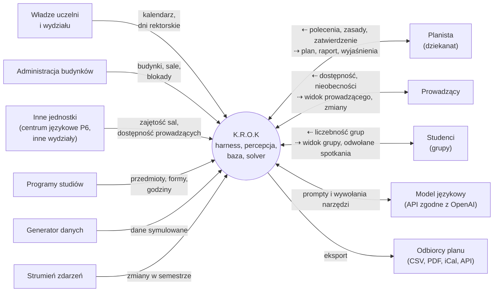

# Problem, cel i otoczenie systemu

> Szkic do #2. Opisuje, po co jest K.R.O.K, z kim się komunikuje i czego nie robi. Encje, pola i formaty plików są w [modelu domeny](model-domeny.md) (#1), a kryteria poprawnego planu w #3.

## Zakres

Wydział Informatyki (WJ) Politechniki Opolskiej, budynki P1–P6 (P4 nie ma sal dydaktycznych). P6 należy do ogólnouczelnianego centrum językowego, ale stoi na naszym wydziale. Najpierw testujemy system na jednym kierunku, potem na całym wydziale. Cała uczelnia to opcjonalne rozszerzenie po Sprincie 3.

## Problem

Plan semestru to tysiące spotkań. Każde musi dostać dzień, godzinę, salę i prowadzącego, a decyzje wpływają na siebie nawzajem:

- **Skala.** Wydział ma wiele kierunków, stopni (inż., lic., mgr), trybów (dzienne pn–pt, zaoczne so–nd) i roczników. Każdy rocznik dzieli się na grupy wykładowe, ćwiczeniowe i laboratoryjne.
- **Hierarchia grup.** Lab podgrupy nie może nakładać się na wykład całego rocznika. Kolizję trzeba sprawdzać w całym drzewie grup, nie tylko w obrębie jednej grupy.
- **Wspólne zasoby.** Budynki, sale i prowadzący są współdzieleni przez kierunki. Przesunięcie jednych zajęć może wywołać kolizję zupełnie gdzie indziej.
- **Ograniczenia z zewnątrz.** Prowadzący spoza wydziału (np. matematyka, fizyka, języki obce) są dostępni tylko w części tygodnia. Sale w P6 zajmują też inne wydziały.
- **Czas bez sztywnej siatki.** Zajęcia mają dowolną godzinę startu, a przerwy i czasy przejść między budynkami wynikają z reguł. Nie da się ułożyć planu w zwykłej tabeli z równymi slotami.
- **Sprzeczne cele.** Mniej okienek dla studentów to często więcej przejść między budynkami albo gorsze godziny dla prowadzących. Trzeba wybrać kompromis i umieć go wyjaśnić.
- **Zmiany.** W trakcie semestru prowadzący chorują, sale wypadają z użycia, a liczebność grup się zmienia. Plan trzeba poprawić tak, żeby zmieniło się w nim jak najmniej.
- **Zasady też się zmieniają.** Godziny, przerwy i priorytety ustala się na nowo przed każdym układaniem. Jeśli są zaszyte w kodzie albo w głowie planisty, każda zmiana oznacza ręczną pracę.

Przy ręcznym układaniu kolizje wychodzą późno, a jakość planu (okienka, przejścia) jest trudna do zmierzenia i porównania między wersjami.

## Cel

K.R.O.K układa tygodniowy plan zajęć wydziału i utrzymuje go w trakcie semestru:

1. **Plan bez kolizji.** Żadna grupa (razem z przodkami i potomkami), prowadzący ani sala nie mają dwóch zajęć naraz. Sala ma właściwy typ i pojemność, a prowadzący uczy tylko w godzinach dostępności.
2. **Dobry plan.** Jak najmniej okienek studentów i przejść między budynkami, zajęcia rozłożone równo w tygodniu.
3. **Zasady jako dane.** Godziny, przerwy, reguły twarde i miękkie oraz wagi są w `config.json` i `calendar.json`. Zmiana zasad oznacza ponowne ułożenie planu, bez zmian w kodzie.
4. **Reakcja na zmiany.** Po zdarzeniu z otoczenia system poprawia plan z minimalną liczbą zmian albo tylko aktualizuje terminarz, jeśli zmiana jest krótka.
5. **Wyjaśnianie.** Planista dostaje raport z metrykami i naruszeniami. Gdy planu nie da się ułożyć, system wskazuje przyczynę zamiast pustego wyniku.
6. **Polecenia w zwykłym języku.** Planista pisze np. „Kowalski choruje do piątku”, a model dobiera narzędzia.

Mierzalne kryteria realizacji tych celów są w #3.

## Otoczenie

### Kto korzysta i kto dostarcza dane

| Uczestnik | Co daje systemowi | Co dostaje od systemu |
|---|---|---|
| **Planista** (dziekanat, osoba układająca plan) | polecenia w zwykłym języku, zasady w `config.json` i `calendar.json`, zatwierdzenie planu | plan, raport metryk i naruszeń, wyjaśnienia, warianty do wyboru |
| **Prowadzący** | godziny dostępności, kompetencje, budynek macierzysty, limit godzin, nieobecności | swój widok planu, informacje o zmianach |
| **Studenci** (przez grupy) | liczebność grup, podział na grupy, tryb studiów | widok planu grupy, odwołane spotkania |
| **Władze uczelni i wydziału** | kalendarz semestru, dni i godziny rektorskie lub dziekańskie, odpracowania | — |
| **Administracja budynków** | budynki i sale: typ, pojemność, współrzędne, remonty i blokady | widok zajętości sal |
| **Inne jednostki uczelni** (centrum językowe w P6, inne wydziały) | zajętość wspólnych sal (`resourceBlock`), dostępność swoich prowadzących | — |
| **Programy studiów** | przedmioty z formami (W/Ć/L/P), godzinami, typem sali i parzystością | — |

W projekcie budynki i sale wpisujemy ręcznie z rzeczywistości (#6). Resztę danych (grupy, prowadzący, przedmioty, zajęcia, kalendarz) wypełnia generator (#7), bo prawdziwych danych nie mamy.

### Z czym system się komunikuje

| System zewnętrzny | Kierunek | Jak |
|---|---|---|
| Pliki wejściowe (JSON/CSV) | wejście | import i czyszczenie w percepcji (#9) |
| Generator danych | wejście | pliki w formacie z #1, presety `mini`, `kierunek`, `wydzial`, `edge-cases` (#7) |
| Strumień zdarzeń | wejście | JSONL `timestamp`, `type`, `payload` (#8) |
| Model językowy | w obie strony | API zgodne z OpenAI, adres i model w `.env` (domyślnie lokalny) |
| Solver CP-SAT | w obie strony | narzędzie `solve_plan` w harnessie ([decyzja 001](../decyzje/001-solver.md)) |
| Odbiorcy planu | wyjście | eksport CSV, PDF, iCal, API |

Model językowy i solver są elementami wewnątrz systemu (harness wywołuje je jak narzędzia), ale model może działać poza naszą maszyną. Dane, które do niego trafiają, opuszczają wtedy system. Ryzyka z tym związane opisuje #20.

### Skąd przychodzą zmiany w trakcie semestru

| Zmiana | Źródło | Skutek w systemie |
|---|---|---|
| Nieobecność prowadzącego (choroba, wyjazd) | prowadzący, dziekanat | krótka: terminarz i raport, długa: ponowne planowanie z zastępstwem |
| Zmiana dostępności prowadzącego | prowadzący | ponowne planowanie |
| Sala niedostępna (remont, awaria, zajęcie przez inną jednostkę) | administracja, inne jednostki | `resourceBlock`, krótka blokada zmienia terminarz, długa trafia do solvera |
| Zmiana liczebności grupy, nowa grupa | dziekanat | ponowne planowanie, możliwa zmiana sali |
| Nowy przedmiot lub zmiana programu | dziekanat | ponowne planowanie |
| Dzień wolny, godziny rektorskie, odpracowanie | władze uczelni | wpis w `calendar.json`, zmienia tylko terminarz |
| Zmiana zasad (przerwy, godziny, wagi) | planista | ponowne ułożenie planu |

W projekcie zmiany symuluje strumień zdarzeń (#8). Zasada z [architektury](../architektura.html): trwałe zmiany uruchamiają ponowne planowanie, a dni wolne i krótkie blokady zmieniają tylko terminarz i raport.

## Diagram kontekstu

System w środku, otoczenie dookoła. Strzałki pokazują kierunek przepływu informacji. Na strzałkach dwukierunkowych ⇠ to dane do systemu, a ⇢ dane z systemu.

Wnętrze systemu (harness, narzędzia, solver, baza) pokazuje [diagram architektury](../architektura.html).

## Granice systemu

### Robimy

- Tygodniowy plan zajęć (opcjonalnie z tygodniami A/B) dla studiów dziennych i jednego powtarzalnego weekendu dla zaocznych.
- Przydział dnia, godziny startu, sali i (gdy nie jest podany) prowadzącego z odpowiednią kompetencją.
- Kalendarz semestru: nałożenie planu na daty, dni wolne, godziny rektorskie, odpracowania, blokady.
- Ponowne planowanie po zmianie zasad lub danych, z minimalną liczbą zmian.
- Raport metryk i naruszeń, widoki per grupa, prowadzący i sala, eksport.
- Wykrywanie błędów i braków w danych wejściowych (percepcja, #9–#11).

### Nie robimy

- **Zapisy studentów na przedmioty i do grup.** Dostajemy gotowy podział na grupy i ich liczebność.
- **Rezerwacje sal ad hoc** (konsultacje, spotkania, wydarzenia). Zajętość sali przez kogoś z zewnątrz przyjmujemy jako blokadę.
- **Układanie programów studiów.** Przedmioty, formy i godziny są danymi wejściowymi.
- **Przydział pensum i rozliczanie godzin prowadzących.** Uwzględniamy tylko tygodniowy limit jako ograniczenie.
- **Sesja egzaminacyjna i terminy egzaminów.**
- **Różne zajęcia na różnych zjazdach studiów zaocznych.** Na razie układamy jeden powtarzalny weekend.
- **Integracja z systemami uczelni** (np. USOS). Plan wychodzi przez eksport w wybranym formacie.
- **Cała uczelnia.** Współdzielenia zasobów między wydziałami nie modelujemy. Prowadzący spoza wydziału to zwykli prowadzący z ograniczoną dostępnością, a zajęte przez innych sale to blokady. Rozszerzenie na uczelnię jest opcjonalne po Sprincie 3.
- **Samodzielna publikacja planu.** System proponuje plan i zmiany, a publikuje je planista (#20).

## Wejścia i wyjścia

Pliki wejściowe, encje i formaty wyjść (plan, raport, widoki, terminarz) opisuje [model domeny](model-domeny.md) (#1).
